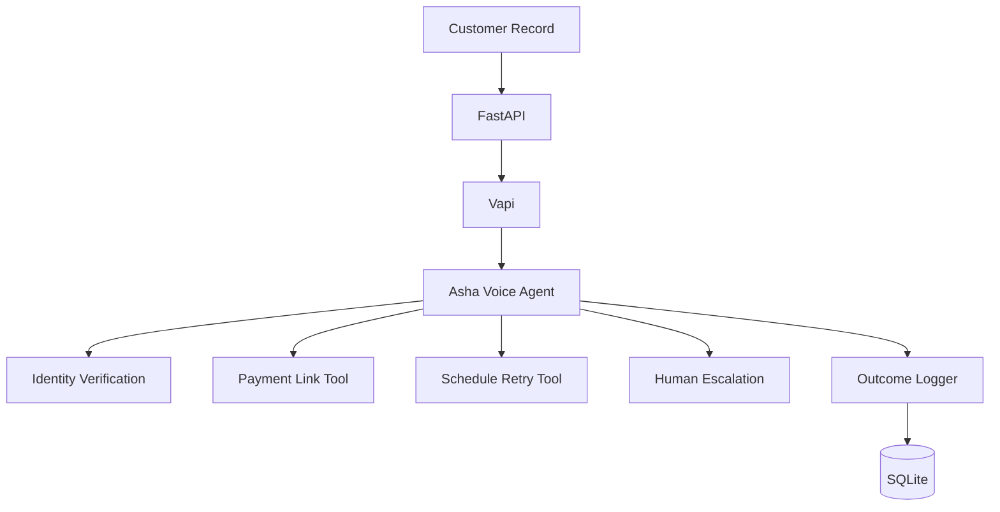

# Autopay Recovery Voice Agent

Take-home assignment for Razorpay's **Forward-Deployed Engineer, Agent Studio**
role — **Option 2: Voice Agent for Autopay Recovery** (Vapi provider).

**Asha**, an AI voice agent, calls customers whose fictional autopay payment
failed, verifies their identity, explains the failure in plain language, and
helps them recover via a **secure demo payment link** — never by charging a
card or collecting sensitive credentials.

## Why this approach

- **Voice agent** — failed autopay is a high-friction moment; a short,
  empathetic call resolves it faster than email/SMS blasts.
- **Secure payment-link recovery** — the primary mechanism is a mock
  payment link sent by SMS. The agent never touches card numbers, CVV,
  OTP, UPI PINs, or passwords.
- **Human escalation** — disputes, hardship, and angry customers are
  handed to a human instead of being pushed through automation.
- **Mock payment environment** — demo links use the non-routable
  `.invalid` domain; no real gateway, no real money, ever.
- **Safety-first design** — identity verification before any disclosure,
  wrong-person protection, do-not-call honored instantly, and every tool
  call validated server-side.

## Architecture



See [docs/architecture.md](docs/architecture.md) for details.

## Setup (Windows-friendly)

```bash
python -m venv .venv
.venv\Scripts\activate
pip install -r requirements.txt
```

```bash
copy .env.example .env
```

Fill in `.env`:

| Variable | Meaning |
|---|---|
| `VAPI_API_KEY` | Vapi API key (dashboard.vapi.ai) |
| `VAPI_ASSISTANT_ID` | Asha assistant id (or create via `create_assistant`) |
| `VAPI_PHONE_NUMBER_ID` | Vapi phone number id for outbound calls |
| `DEMO_PHONE_NUMBER` | The **only** number the backend may call — must be yours |
| `DATABASE_URL` | SQLite URL (default `sqlite:///./autopay.db`) |
| `PUBLIC_BASE_URL` | Public HTTPS URL of this API (**required** for live Vapi: tools + webhooks; backend fails clearly without it) |
| `VAPI_WEBHOOK_SECRET` | Shared secret for `POST /webhooks/vapi` — send as `X-Webhook-Secret` header; mismatches get 401 |

Seed the database:

```bash
python scripts/seed.py
```

## Run the API

```bash
uvicorn app.main:app --reload
```

Endpoints: `GET /health`, `GET /customers`, `GET /customers/{id}`,
`POST /calls/start`, `GET /calls`, `GET /calls/{id}`,
`GET /calls/{id}/trace`, `POST /webhooks/vapi`.

## Run tests

```bash
pytest -v
```

## Run the evaluation (all 10 scenarios, executed for real)

```bash
python scripts/evaluate.py
```

## Run the mock demo (no phone call)

```bash
python scripts/demo.py --mock
```

## Run the live demo (Vapi call to your demo number only)

```bash
python scripts/demo.py --live CUST001
```

Live mode requires Vapi credentials and an authorized `DEMO_PHONE_NUMBER`.
The backend refuses to dial anything else and only calls between
9 AM and 8 PM customer-local time.

## Vapi configuration

1. Create the assistant in the Vapi dashboard named **Asha**, or call
   `app.vapi.create_assistant(settings)` once and store the returned id in
   `VAPI_ASSISTANT_ID`.
2. Per-call overrides (`app/vapi.py::build_assistant_overrides`) inject the
   rendered system prompt, first message
   ("Hello, may I speak with {{customer_name}}?"), the five function tools,
   and an Indian-English/Hindi-compatible voice. Calls target ~5 minutes max.
3. Point Vapi's server URL for tools to `https://<your-host>/webhooks/vapi`.
   The backend also sets `serverUrl` and `serverMessages`
   (`tool-calls`, `end-of-call-report`, `status-update`) in code
   (`app/vapi.py::build_assistant_overrides`).
4. Secure the webhook: set `VAPI_WEBHOOK_SECRET` in `.env` and configure
   Vapi to send the same value in the `X-Webhook-Secret` header.
   Requests with a missing/wrong header are rejected with 401.
   (If the secret is left empty, the webhook accepts unauthenticated
   requests — local development only.)
5. Supported languages: English, Hindi, Hinglish (starts in the customer's
   configured language).

## Project structure

```
razorpay-autopay-voice-agent/
├── app/
│   ├── main.py        # FastAPI app + 8 endpoints + Vapi webhook
│   ├── config.py      # env-based settings
│   ├── database.py    # SQLite schema + helpers
│   ├── models.py      # Pydantic models
│   ├── customers.py   # customer records (verification_suffix stays server-side)
│   ├── payments.py    # mock demo payment links (.invalid domain)
│   ├── policies.py    # calling safety + 10-scenario engine + compliance checks
│   ├── tools.py       # the 5 backend tools
│   ├── vapi.py        # Vapi REST client + assistant config
│   └── prompts.py     # Asha's prompts (system prompt used verbatim)
├── data/customers.json
├── scripts/seed.py | demo.py | evaluate.py
├── tests/ (33 tests)
└── docs/architecture.md | agent-behavior.md | limitations.md | demo.md
```

## Safety notes

- All 10 customers are fictional (`+91-DEMO-XXXX` numbers).
- `verification_suffix` is never sent to Vapi, the LLM, or API responses
  (asserted by tests).
- `POST /calls/start` only ever dials `DEMO_PHONE_NUMBER`.
- See [docs/limitations.md](docs/limitations.md) — this is a demo, not
  production-compliant.
